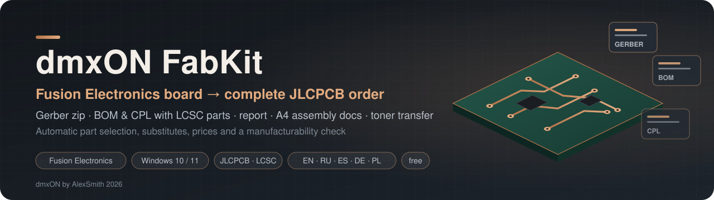

<p align="center">
  
</p>

<p align="center">
  <a href="https://github.com/AlexSmith2025/dmxON-FabKit/releases/latest"></a>
  <a href="https://github.com/AlexSmith2025/dmxON-FabKit/releases"></a>
  
  
  <a href="https://www.paypal.com/donate/?business=smith.show2025%40gmail.com&no_recurring=0&item_name=dmxON+FabKit&currency_code=EUR"></a>
</p>

<p align="center">
  <a href="https://github.com/AlexSmith2025/dmxON-FabKit/releases/latest/download/dmxON-FabKit.zip"></a>
</p>

<p align="center">
  <a href="README.md">English</a> · <b>Русский</b> &nbsp;|&nbsp;
  <a href="#быстрый-старт">Быстрый старт</a> ·
  <a href="#совместимость">Совместимость</a> ·
  <a href="#что-получается">Что получается</a> ·
  <a href="#заказ-на-jlcpcb">Заказ</a> ·
  <a href="#поддержать-проект">Поддержать</a>
</p>

**dmxON FabKit — ULP для Autodesk Fusion Electronics (Fusion 360 Electronics), который за один запуск делает из платы полный заказ JLCPCB: архив Gerber с именами JLCPCB, BOM и CPL с автоматическим подбором деталей LCSC и заменами, интерактивный отчёт, документацию A4 для ручной сборки и листы ЛУТ 1:1.**

<p align="center">
  <a href="https://www.paypal.com/donate/?business=smith.show2025%40gmail.com&no_recurring=0&item_name=dmxON+FabKit&currency_code=EUR"></a>
</p>

---

## Что делает

| | |
|---|---|
| 🏭 | **Gerber и сверловка под JLCPCB**: имена GTL/GBL/G1…/GTS/GTP/GTO/GKO/XLN, архив для загрузки; слои и параметры платы определяются сами |
| 🧾 | **BOM и CPL для сборки** с автоматическим подбором номеров LCSC — резисторы и конденсаторы по номиналу, корпусу и напряжению, остальное по номеру изготовителя |
| 📐 | **Сверка посадочных мест** с библиотекой JLC (EasyEDA): поворот и центр в CPL — по совмещению площадок; зеркальные и неподходящие корпуса помечаются |
| 🔁 | **Замены**: если детали нет, нет на складе или корпус не подходит — ищется аналог, проверяется по площадкам платы, выбирается самый дешёвый |
| 💲 | **Стоимость**: цены каталога на весь тираж, плата за катушки Extended, самые дорогие позиции |
| 📊 | **Отчёт HTML**: реалистичный вид платы, переключатели слоёв, галерея Gerber, сверловка, проверка технологичности, расстановка с обозначениями |
| 📄 | **Документация A4** для ручной сборки: титул, параметры изготовления, слои, сборочные чертежи в стандартном масштабе, порядок пайки по шагам, ключи микросхем, спецификация; штамп правится в браузере; PDF |
| 🖨️ | **ЛУТ 1:1**: PDF каждого слоя (медь, шелкография, маска, сверловка), верх зеркальный, шкала 50 мм |
| 📥 | **Импорт готовой BOM JLCPCB** (xlsx, csv или текст со страницы заказа) — ваши проверенные номера главнее |
| 🌐 | Всё — **на русском и английском** |

---

## Совместимость

| | dmxON FabKit |
|---|---|
| **Autodesk Fusion (Electronics), Windows 10/11** | ✅ проверено на Fusion **2705.1.11** (октябрь 2026) |
| Autodesk Fusion на macOS | ❌ использует инструменты Windows (`curl.exe`, `tar.exe`, Windows Script Host, Microsoft Edge) |
| EAGLE 9.x | ❌ для Gerber нужна команда Fusion `MANUFACTURING EXPORT` |
| KiCad, Altium, EasyEDA | ❌ |

Ещё нужны: **Microsoft Edge** (есть в Windows) — для PDF; интернет — для каталога JLCPCB и посадочных мест EasyEDA (без него всё остальное работает). Если новая сборка Fusion что-то сломала — [напишите в issues](https://github.com/AlexSmith2025/dmxON-FabKit/issues).

---

## Установка

1. [**Скачайте `dmxON-FabKit.zip`**](https://github.com/AlexSmith2025/dmxON-FabKit/releases/latest/download/dmxON-FabKit.zip) и распакуйте в любую папку, например `Документы\dmxON-FabKit`.
2. Структуру не меняйте: `dmxON_FabKit.ulp` ищет модули в `lib\` и настройки в `config\` рядом с собой.
3. По желанию добавьте папку в **Electronics → Preferences → Directories → ULPs**.

---

## Быстрый старт

1. Откройте **плату** в Fusion Electronics и **сохраните её** (Ctrl+S) — Gerber Fusion делает из последней сохранённой версии.
2. Запустите **Automation → Run ULP → `dmxON_FabKit.ulp`** или `RUN 'C:/путь/dmxON_FabKit.ulp'`.
3. В диалоге выберите папку и нажмите **Создать пакет**.
4. Fusion может показать окно **CAM Export File List** — нажмите **OK** (это штатная выгрузка Gerber).
5. Через минуту откроется папка пакета. Начните с `index.html`.

Совет: сначала запустите [**dmxON JLC Rules**](https://github.com/AlexSmith2025/dmxON-JLC-Rules) — он настроит правила и стек слоёв JLCPCB и передаст в FabKit толщину платы и цвет маски.

### Диалог

| Вкладка | Что настраивается |
|---|---|
| **Выгрузка** | папка; что создать: Gerber, документацию A4, PDF, листы ЛУТ; что идёт в BOM/CPL: THT, центр площадок, исключаемые обозначения |
| **Детали** | поиск в каталоге, Basic/Preferred, замены, сверка посадочных мест, перепроверка атрибутов, запись `LCSC_PART`, число плат, мин. напряжение конденсаторов, плата за катушку, импорт BOM |
| **Плата** | толщина, цвет маски и шелкографии, покрытие — для отчёта, формы заказа и вида платы |
| **Штамп** | изделие, обозначение, редакция, заказчик, примечание (у каждой платы свои); организация и подписи (общие) |
| **Инфо** | версия, автор, лицензия, ссылки |

Все настройки запоминаются.

---

## Что получается

```
<плата>_FabKit/
├── index.html                          стартовая страница
├── 01_JLCPCB_ORDER/
│   ├── JLCPCB_GERBER/
│   │   ├── <плата>_Gerber_JLCPCB.zip   ← загрузить на jlcpcb.com
│   │   └── unpacked/                   те же файлы для просмотра
│   ├── <плата>_JLCPCB_BOM.csv          ← PCB Assembly: BOM
│   └── <плата>_JLCPCB_CPL.csv          ← PCB Assembly: CPL
├── 02_REPORT/                          отчёт + превью слоёв
├── 03_ASSEMBLY_DOCS/                   документация A4 (HTML + PDF)
└── 04_TONER_TRANSFER_1to1/             HOW_TO_PRINT + 7 листов PDF
```

При каждом запуске пакет платы **удаляется и создаётся заново** — но только если папку создал FabKit (в ней метка `.dmxon-fabkit`). Чужую папку с тем же именем FabKit не тронет.

---

## Заказ на JLCPCB

1. **jlcpcb.com → Order now → Add gerber file** → `01_JLCPCB_ORDER/JLCPCB_GERBER/<плата>_Gerber_JLCPCB.zip`.
2. Параметры платы — из отчёта (раздел «Заказ»).
3. **PCB Assembly** → BOM `…_JLCPCB_BOM.csv`, CPL `…_JLCPCB_CPL.csv`.
4. В предпросмотре JLCPCB проверьте детали из раздела отчёта **«Требуют внимания»**.

### Номера деталей — что главнее

1. **Импорт BOM** (вкладка «Детали» или `-import файл`).
2. **Атрибут** на детали: `LCSC_PART`, `LCSC`, `JLCPCB_PART`, `JLC` …
3. **Подбор по каталогу JLCPCB**: R/C — по номиналу, корпусу и напряжению; остальное — по номеру изготовителя из номинала или атрибута `MPN` / `MANUFACTURER_PART_NUMBER`.
4. **Замена**, если детали нет, нет на складе или корпус не подходит.

Полезные атрибуты: `JLC_PACKAGE`, `JLC_ROTATION`, `JLC_COMMENT`, `VOLTAGE`, `DNP` / `JLC_EXCLUDE`, `BOM=EXCLUDE`. Своё сопоставление корпусов и поворотов — `config/fk_package_map.txt`.

---

## ЛУТ

Листы строятся из **тех же Gerber**, что уходят на завод: заливки, зазоры и вырезы точные; белые точки — центры отверстий. Печать на лазерном принтере **100 % / «Фактический размер»**, без «Вписать в страницу»; проверьте шкалу 50 мм. Верх уже зеркальный, низ — нет.

---

## Пакетный режим

```
RUN dmxON_FabKit.ulp -batch <папка> [-offline] [-boards N] [-import файл] [-nogerber] [-nodocs] [-notoner] [-nopdf] [-keep]
```

| Ключ | Значение |
|---|---|
| `-batch <папка>` | без диалога, в эту папку, атрибуты не пишутся |
| `-offline` | без каталога и EasyEDA |
| `-boards N` | плат в заказе |
| `-import <файл>` | BOM JLCPCB (xlsx/csv/txt) |
| `-nogerber -nodocs -notoner -nopdf` | пропустить часть пакета |
| `-keep` | оставить временную папку для разбора |

---

## Если что-то не так

| Симптом | Что делать |
|---|---|
| Окно **CAM Export File List** | нажать **OK**: Fusion подтверждает выгрузку Gerber |
| «Your PCB design has changed. CAM output is generated using the last saved version» | нажмите **Cancel**, сохраните плату (Ctrl+S) и запустите FabKit снова — иначе Gerber получится из старой сохранённой версии (например, без новых правил) |
| «Каталог JLCPCB не ответил» | проверьте интернет и прокси; без сети пакет всё равно собирается |
| Нет PDF | нужен Microsoft Edge (или Chrome) в стандартной папке |
| «Требуют внимания» | прочитайте каждую строку: напряжения, полярность, цоколёвка, склад |

---

## Как устроено

Фаза 1 (ULP) анализирует плату и пишет BOM/CPL и заготовки, фаза 2 (команды Fusion) делает `MANUFACTURING EXPORT`, фаза 3 (тот же ULP с `-finish`) собирает Gerber, превью, отчёт, документацию и листы ЛУТ. Подробно: [docs/ARCHITECTURE.md](docs/ARCHITECTURE.md) · история версий: [CHANGELOG.md](CHANGELOG.md).

---

## Поддержать проект

dmxON FabKit — **бесплатный**. За ним недели работы: свой разбор Gerber и Excellon, подбор деталей по каталогу JLCPCB, совмещение посадочных мест, документация и реальные заказы, по которым всё сверено. Если он сэкономил вам вечер подготовки заказа, уберёг от неверной детали или неудачной сборки — поддержите развитие: новые версии, изменения каталога JLCPCB и исправления под свежие выпуски Fusion.

<p align="center">
  <a href="https://www.paypal.com/donate/?business=smith.show2025%40gmail.com&no_recurring=0&item_name=dmxON+FabKit&currency_code=EUR"></a>
</p>

<p align="center">
  <b>PayPal:</b> <a href="https://www.paypal.com/donate/?business=smith.show2025%40gmail.com&no_recurring=0&item_name=dmxON+FabKit&currency_code=EUR">smith.show2025@gmail.com</a> — любая сумма помогает. Спасибо! ⭐ Звезда на GitHub тоже помогает другим найти проект.
</p>

---

## Лицензия

Бесплатно с указанием автора; копирование кода, изменение и коммерческое использование запрещены — см. [LICENSE.md](LICENSE.md). JLCPCB и LCSC — товарные знаки их владельцев; проект с ними не связан.

**dmxON by AlexSmith 2026** · [dmxon512.com](https://dmxon512.com) · сопутствующий проект: [dmxON JLC Rules](https://github.com/AlexSmith2025/dmxON-JLC-Rules)
